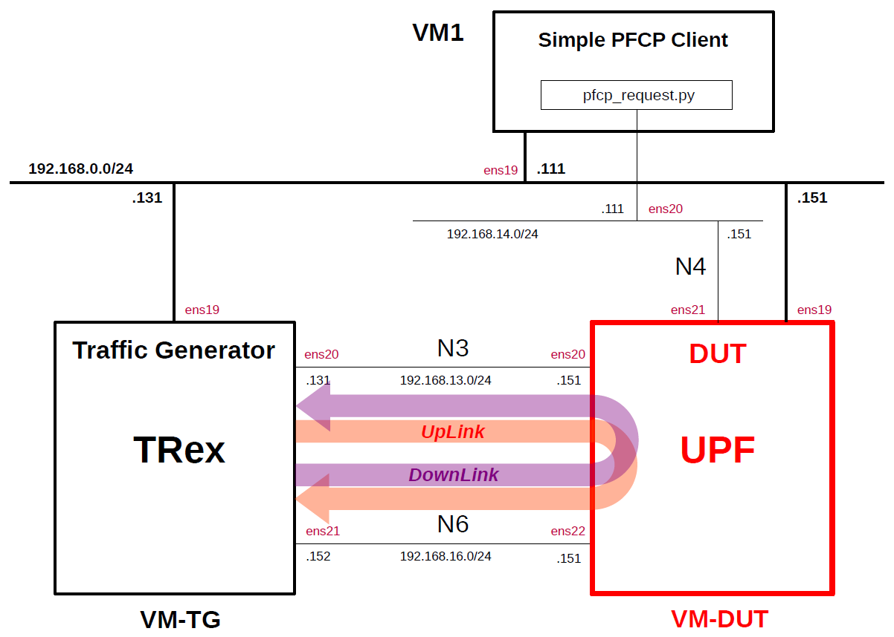

# Simple Measurement of UPF Performance 10
This describes simple performance measurements of several open source UPFs by using the traffic generator [TRex](https://github.com/cisco-system-traffic-generator/trex-core) as the performance measurement tool and [Simple PFCP Client](https://github.com/s5uishida/simple_pfcp_client) as the PFCP simulator.
This was measured on the VMs on Proxmox VE.
For other measurement results, please see [Performance Measurement](https://github.com/s5uishida/sample_config_misc_for_mobile_network#performance_measurement).

**Note. Performance measurement results are highly dependent on the measurement conditions. These results are only examples of results under certain measurement conditions.
And this is a very simple measurement, and according to [this comment](https://github.com/open5gs/open5gs/discussions/1780#discussioncomment-10853290), it doesn't seem to make much sense to measure between VMs. I hope it will serve as a reference for a simple configuration when measuring on real devices.**

---

### [Sample Configurations and Miscellaneous for Mobile Network](https://github.com/s5uishida/sample_config_misc_for_mobile_network)

---

<a id="toc"></a>

## Table of Contents

- [Simple Overview of UPF Performance Measurements](#overview)
- [Changes in configuration files of Simple PFCP Client, TRex and UPFs](#changes)
  - [Changes in configuration files of Simple PFCP Client](#changes_pfcp)
  - [Changes in configuration files of TRex](#changes_trex)
  - [Changes in configuration files of UPFs](#changes_up)
    - [a-1. Changes in configuration files of Open5GS 5GC UPF (TUN)](#changes_up_a1)
    - [a-2. Changes in configuration files of Open5GS 5GC UPF (TAP)](#changes_up_a2)
    - [b. Changes in configuration files of free5GC 5GC UPF](#changes_up_b)
    - [c. Changes in configuration files of UPG-VPP](#changes_up_c)
    - [d. Changes in configuration files of eUPF](#changes_up_d)
    - [e-1. Changes in configuration files of OAI-CN5G-UPF (Simple Switch)](#changes_up_e1)
    - [e-2. Changes in configuration files of OAI-CN5G-UPF (eBPF/XDP)](#changes_up_e2)
- [Network settings of TRex and UPFs](#network_settings)
  - [Network settings of TRex](#network_settings_trex)
  - [a-1. Network settings of Open5GS 5GC UPF (TUN)](#network_settings_up_a1)
  - [a-2. Network settings of Open5GS 5GC UPF (TAP)](#network_settings_up_a2)
  - [b. Network settings of free5GC 5GC UPF](#network_settings_up_b)
  - [c. Network settings of UPG-VPP](#network_settings_up_c)
  - [d. Network settings of eUPF](#network_settings_up_d)
  - [e-1. Network settings of OAI-CN5G-UPF (Simple Switch)](#network_settings_up_e1)
  - [e-2. Network settings of OAI-CN5G-UPF (eBPF/XDP)](#network_settings_up_e2)
- [Build Simple PFCP Client, TRex and UPFs](#build)
- [Run Simple PFCP Client, TRex and UPFs](#run)
  - [Run UPFs](#run_up)
    - [a-1. Run Open5GS 5GC UPF (TUN)](#run_up_a1)
    - [a-2. Run Open5GS 5GC UPF (TAP)](#run_up_a2)
    - [b. Run free5GC 5GC UPF](#run_up_b)
    - [c. Run UPG-VPP](#run_up_c)
    - [d. Run eUPF](#run_up_d)
    - [e-1. Run OAI-CN5G-UPF (Simple Switch)](#run_up_e1)
    - [e-2. Run OAI-CN5G-UPF (eBPF/XDP)](#run_up_e2)
  - [Run Simple PFCP Client](#run_pfcp)
  - [Run TRex](#run_trex)
- [Measure UPF Performance](#measure)
- [Results](#results)
  - [Load measurement](#load_measurement)
  - [Latency measurement](#latency_measurement)
  - [Summary](#summary)
  - [Performance of N6 interface only](#n6_performance)
- [Changelog (summary)](#changelog)

---

<a id="overview"></a>

## Simple Overview of UPF Performance Measurements

I will easily measure the performance of several open source UPFs by using TRex as the traffic generator and Simple PFCP Client as the PFCP simulator.
**Note that this configuration is implemented with Proxmox VE VMs.**

The following minimum configuration was set as a condition.
- One PFCP client, TRex and DUT (UPF)

The built simulation environment is as follows.

</img>

Simple PFCP Client, TRex used are as follows.
- Simple PFCP Client (2026.01.14) - https://github.com/s5uishida/simple_pfcp_client
- TRex v3.08 (2025.11.05) - https://github.com/cisco-system-traffic-generator/trex-core
- Scapy v2.6.1 (2024.11.05) - https://github.com/secdev/scapy

The UPFs used are as follows.
- Open5GS v2.8.0 (2026.08.07) - https://github.com/open5gs/open5gs
- free5GC UPF (go-upf) v1.2.8 (2026.01.05) - https://github.com/free5gc/go-upf  
  gtp5g v0.9.16 (2025.12.02) - https://github.com/free5gc/gtp5g
- UPG-VPP v1.13.0 (2024.03.25) - https://github.com/travelping/upg-vpp
- eUPF v0.7.1 (2026.10.05) - https://github.com/edgecomllc/eupf
- OAI-CN5G-UPF v2.2.1 (2026.10.07) - https://github.com/openairinterface/oai-cn5g-upf

Each VMs are as follows.  
| VM | SW & Role | IP address | OS | CPU | Mem | HDD |
| --- | --- | --- | --- | --- | --- | --- |
| VM1 | Simple PFCP Client | 192.168.0.111/24 | Ubuntu 24.04 | 1 | 1GB | 10GB |
| VM-TG | TRex<br>Traffic Generator | 192.168.0.131/24 | Ubuntu 24.04 | 3 | 8GB | 10GB |
| **VM-DUT** | **each UPF DUT<br>(Device Under Test)** | **192.168.0.151/24** | **Ubuntu 24.04** | **2** | **8GB** | **20GB** |

**Each VM-DUT(UPFs) are as follows.**
| # | SW / *packet processing* | Date | Commit | OS |
| --- | --- | --- | --- | --- |
| a | Open5GS UPF v2.8.0<br>***user space*** | 2026.08.07 | `8f25f3beaf131a5e979534dfda4a27765321dfd0` | Ubuntu 24.04 |
| b | free5GC UPF<br>(go-upf) v1.2.8<br>***kernel module*** | 2026.01.05 | `b798fe5ee6a984be492fa53958dd5f1305469f85` | Ubuntu 24.04 |
| c | UPG-VPP v1.13.0<br>***DPDK/VPP*** | 2024.03.25 | `dfdf64000566d35955d7c180720ff66086bd3572` | Ubuntu 24.04 |
| d | eUPF v0.7.1<br>***eBPF/XDP*** | 2026.10.05 | `48f257edff3030b5a653d9484611636c05986a7f` | Ubuntu 24.04 |
| e | OAI-CN5G-UPF v2.2.1<br>***eBPF/XDP*** | 2026.10.07 | `7a028b7bef5a8d7a96e0f4b9d7d2fe6e9db726a0` | Ubuntu 24.04 |

The network interfaces of each VM except VM-DUT are as follows.
| VM | Device | Model | Linux Bridge | IP address | Interface |
| --- | --- | --- | --- | --- | --- |
| VM1 | ens18 | VirtIO | vmbr1 | 10.0.0.111/24 | (NAPT NW) |
| | ens19 | VirtIO | mgbr0 | 192.168.0.111/24 | (Mgmt NW) |
| | ens20 | VirtIO | vmbr4 | 192.168.14.111/24 | N4 |
| VM-TG | ~~ens18~~ | ~~VirtIO~~ | ~~vmbr1~~  | ~~10.0.0.131/24~~ | ~~(NAPT NW)~~ ***down*** |
| | ens19 | VirtIO | mgbr0 | 192.168.0.131/24 | (Mgmt NW) |
| | ens20 | VirtIO | vmbr3 | 192.168.13.131/24 | N3 ***(Under DPDK by uio_pci_generic)*** |
| | ens21 | VirtIO | vmbr6 | 192.168.16.152/24 | N6 ***(Under DPDK by uio_pci_generic)*** |

**The network interfaces of each VM-DUT(UPFs) are as follows.**
| # | SW | Device | Model | Linux Bridge | IP address | Interface |
| --- | --- | --- | --- | --- | --- | --- |
| a | Open5GS UPF | ~~ens18~~ | ~~VirtIO~~ | ~~vmbr1~~ | ~~10.0.0.151/24~~ | ~~(NAPT NW)~~ ***down*** |
| | | ens19 | VirtIO | mgbr0 | 192.168.0.151/24 | (Mgmt NW) |
| | | ens20 | VirtIO | vmbr3 | 192.168.13.151/24 | N3 |
| | | ens21 | VirtIO | vmbr4 | 192.168.14.151/24 | N4 |
| | | ens22 | VirtIO | vmbr6 | 192.168.16.151/24 | N6 |
| b | free5GC UPF<br>(go-upf) | ~~ens18~~ | ~~VirtIO~~ | ~~vmbr1~~ | ~~10.0.0.151/24~~ | ~~(NAPT NW)~~ ***down*** |
| | | ens19 | VirtIO | mgbr0 | 192.168.0.151/24 | (Mgmt NW) |
| | | ens20 | VirtIO | vmbr3 | 192.168.13.151/24 | N3 |
| | | ens21 | VirtIO | vmbr4 | 192.168.14.151/24 | N4 |
| | | ens22 | VirtIO | vmbr6 | 192.168.16.151/24 | N6 |
| c | UPG-VPP | ~~ens18~~ | ~~VirtIO~~ | ~~vmbr1~~ | ~~10.0.0.151/24~~ | ~~(NAPT NW)~~ ***down*** |
| | | ens19 | VirtIO | mgbr0 | 192.168.0.151/24 | (Mgmt NW) |
| | | ens20 | VirtIO | vmbr3 | 192.168.13.151/24 | N3 ***(Under DPDK by vfio-pci)*** |
| | | ens21 | VirtIO | vmbr4 | 192.168.14.151/24 | N4 ***(Under DPDK by vfio-pci)*** |
| | | ens22 | VirtIO | vmbr6 | 192.168.16.151/24 | N6 ***(Under DPDK by vfio-pci)*** |
| d | eUPF | ~~ens18~~ | ~~VirtIO~~ | ~~vmbr1~~ | ~~10.0.0.151/24~~ | ~~(NAPT NW)~~ ***down*** |
| | | ens19 | VirtIO | mgbr0 | 192.168.0.151/24 | (Mgmt NW) |
| | | ens20 | VirtIO | vmbr3 | 192.168.13.151/24 | N3 ***(XDP)*** |
| | | ens21 | VirtIO | vmbr4 | 192.168.14.151/24 | N4 |
| | | ens22 | VirtIO | vmbr6 | 192.168.16.151/24 | N6 ***(XDP)*** |
| e | OAI-CN5G-UPF | ~~ens18~~ | ~~VirtIO~~ | ~~vmbr1~~ | ~~10.0.0.151/24~~ | ~~(NAPT NW)~~ ***down*** |
| | | ens19 | VirtIO | mgbr0 | 192.168.0.151/24 | (Mgmt NW) |
| | | ens20 | VirtIO | vmbr3 | 192.168.13.151/24 | N3 ***(XDP)*** |
| | | ens21 | VirtIO | vmbr4 | 192.168.14.151/24 | N4 |
| | | ens22 | VirtIO | vmbr6 | 192.168.16.151/24 | N6 ***(XDP)*** |

Linux Bridges of Proxmox VE are as follows.
| Linux Bridge | Network CIDR | Interface |
| --- | --- | --- |
| vmbr1 | 10.0.0.0/24 | NAPT NW |
| mgbr0 | 192.168.0.0/24 | Mgmt NW |
| vmbr3 | 192.168.13.0/24 | N3 |
| vmbr4 | 192.168.14.0/24 | N4 |
| vmbr6 | 192.168.16.0/24 | N6 |

UE IP address and TEID are as follows.
| UE IP address | UpLink TEID | DownLink TEID |
| --- | --- | --- |
| 10.45.0.2/24 | 0x00000001 | 0x00000002 |

<a id="changes"></a>

## Changes in configuration files of Simple PFCP Client, TRex and UPFs

Please refer to the following for building Simple PFCP Client, TRex and UPFs respectively.
- Simple PFCP Client (2026.01.14) - https://github.com/s5uishida/simple_pfcp_client
- TRex v3.08 (2026.01.14) - https://github.com/s5uishida/install_trex
- Open5GS v2.8.0 (2026.08.07) - https://open5gs.org/open5gs/docs/guide/02-building-open5gs-from-sources/
- free5GC UPF (go-upf) v1.2.8 (2026.01.05) - https://free5gc.org/guide/
- UPG-VPP v1.13.0 (2024.03.25) - https://github.com/s5uishida/install_vpp_upf_dpdk
- eUPF v0.7.1 (2026.10.05) - https://github.com/s5uishida/install_eupf
- OAI-CN5G-UPF v2.2.1 (2026.10.07) - https://github.com/s5uishida/install_oai_upf

<a id="changes_pfcp"></a>

### Changes in configuration files of Simple PFCP Client

See [here](https://github.com/s5uishida/simple_pfcp_client#set_param) for the original file.

- `/root/pfcp_request.py`  
There is no change.

<a id="changes_trex"></a>

### Changes in configuration files of TRex

See [here](https://github.com/s5uishida/install_trex#config) for the original file.

- `/etc/trex_cfg.yaml`  
There is no change.

See [here](https://github.com/s5uishida/install_trex#load_profile) for the original load profiles.

- `/opt/trex/stl/gtp_1pkt_simple.py` for UpLink  
There is no change.

- `/opt/trex/stl/udp_1pkt_simple.py` for DownLink  
There is no change.

See [here](https://github.com/s5uishida/install_trex#latency_profile) for the original latency profiles.

- `/opt/trex/stl/gtp_latency_1pkt_simple.py` for UpLink  
There is no change.

- `/opt/trex/stl/udp_latency_1pkt_simple.py` for DownLink  
There is no change.

<a id="changes_up"></a>

### Changes in configuration files of UPFs

<a id="changes_up_a1"></a>

#### a-1. Changes in configuration files of Open5GS 5GC UPF (TUN)

- `open5gs/install/etc/open5gs/upf.yaml`
```diff
--- upf.yaml.orig       2024-05-02 19:52:00.000000000 +0900
+++ upf.yaml        2024-05-19 12:38:00.000000000 +0900
@@ -11,18 +11,18 @@
 upf:
   pfcp:
     server:
-      - address: 127.0.0.7
+      - address: 192.168.14.151
     client:
 #      smf:     #  UPF PFCP Client try to associate SMF PFCP Server
 #        - address: 127.0.0.4
   gtpu:
     server:
-      - address: 127.0.0.7
+      - address: 192.168.13.151
   session:
     - subnet: 10.45.0.0/16
       gateway: 10.45.0.1
-    - subnet: 2001:db8:cafe::/48
-      gateway: 2001:db8:cafe::1
+      dnn: internet
+      dev: ogstun
   metrics:
     server:
       - address: 127.0.0.7
```

<a id="changes_up_a2"></a>

#### a-2. Changes in configuration files of Open5GS 5GC UPF (TAP)

- `open5gs/install/etc/open5gs/upf.yaml`
```diff
--- upf.yaml.orig       2024-05-02 19:52:00.000000000 +0900
+++ upf.yaml        2024-09-23 14:00:20.724467385 +0900
@@ -11,18 +11,18 @@
 upf:
   pfcp:
     server:
-      - address: 127.0.0.7
+      - address: 192.168.14.151
     client:
 #      smf:     #  UPF PFCP Client try to associate SMF PFCP Server
 #        - address: 127.0.0.4
   gtpu:
     server:
-      - address: 127.0.0.7
+      - address: 192.168.13.151
   session:
     - subnet: 10.45.0.0/16
       gateway: 10.45.0.1
-    - subnet: 2001:db8:cafe::/48
-      gateway: 2001:db8:cafe::1
+      dnn: internet
+      dev: ogstap
   metrics:
     server:
       - address: 127.0.0.7
```

<a id="changes_up_b"></a>

#### b. Changes in configuration files of free5GC 5GC UPF

- `go-upf/upfcfg.yaml`
```diff
--- upfcfg.yaml.orig    2024-10-14 04:53:12.341028732 +0900
+++ upfcfg.yaml 2024-10-14 06:11:36.636303534 +0900
@@ -4,8 +4,8 @@
 # PFCP Configuration
 # The listen IP and nodeID of the N4 interface on this UPF (Can't set to 0.0.0.0)
 pfcp:
-  addr: 127.0.0.8   # IP addr for listening
-  nodeID: 127.0.0.8 # External IP or FQDN can be reached
+  addr: 192.168.14.151   # IP addr for listening
+  nodeID: 192.168.14.151 # External IP or FQDN can be reached
   retransTimeout: 1s # retransmission timeout
   maxRetrans: 3 # the max number of retransmission
 
@@ -18,7 +18,7 @@
   # If you bind to a specific IP, ensure SMF uses the same IP in its N3 configuration.
   # If you bind to all (0.0.0.0), SMF can use any of the available UPF IPs, but do not use 0.0.0.0 in SMF.
   ifList:
-    - addr: 127.0.0.8
+    - addr: 192.168.13.151
       type: N3
       # name: upf.5gc.nctu.me
       # ifname: gtpif
@@ -28,9 +28,7 @@
 # List of Data Network Names (DNN) supported by this UPF.
 dnnList:
   - dnn: internet # Data Network Name
-    cidr: 10.60.0.0/16 # Classless Inter-Domain Routing for assigned IPv4 pool of UE
-  - dnn: internet # Data Network Name
-    cidr: 10.61.0.0/16 # Classless Inter-Domain Routing for assigned IPv4 pool of UE
+    cidr: 10.45.0.0/16 # Classless Inter-Domain Routing for assigned IPv4 pool of UE
     # natifname: eth0
 
 # Logging Configuration
```

<a id="changes_up_c"></a>

#### c. Changes in configuration files of UPG-VPP

See [here](https://github.com/s5uishida/install_vpp_upf_dpdk#conf) for the original files.

- `upg-vpp/startup.conf`  
There is no change.

- `upg-vpp/init.conf`  
There is no change.

<a id="changes_up_d"></a>

#### d. Changes in configuration files of eUPF

See [here](https://github.com/s5uishida/install_eupf#create-configuration-file) for the original file.

- `eupf/config.yml`  
There is no change.

<a id="changes_up_e1"></a>

#### e-1. Changes in configuration files of OAI-CN5G-UPF (Simple Switch)

See [here](https://github.com/s5uishida/install_oai_upf#conf) for the original file.
And change this `config.yaml` to apply [Simple Switch mode](https://github.com/s5uishida/install_oai_upf#ss_conf).
Additionally, to prevent performance degradation, change the log level like [this](https://github.com/s5uishida/install_oai_upf#performance).

- `openair-upf/config.yaml`

<a id="changes_up_e2"></a>

#### e-2. Changes in configuration files of OAI-CN5G-UPF (eBPF/XDP)

See [here](https://github.com/s5uishida/install_oai_upf#conf) for the original file.

- `openair-upf/config.yaml`  
There is no change.

<a id="network_settings"></a>

## Network settings of TRex and UPFs

<a id="network_settings_trex"></a>

### Network settings of TRex

Set the OS kernel parameter according to [this](https://github.com/s5uishida/install_trex#set_param).

<a id="network_settings_up_a1"></a>

### a-1. Network settings of Open5GS 5GC UPF (TUN)

First, uncomment the next line in the `/etc/sysctl.conf` file and reflect it in the OS.
```
net.ipv4.ip_forward=1
```
```
# sysctl -p
```
Next, down the interface `ens18` of the VM-DUT to delete default GW.
```
# ip link set dev ens18 down
```
Then, configure the TUNnel interface.
```
# ip tuntap add name ogstun mode tun
# ip addr add 10.45.0.1/16 dev ogstun
# ip link set ogstun up
```

<a id="network_settings_up_a2"></a>

### a-2. Network settings of Open5GS 5GC UPF (TAP)

First, uncomment the next line in the `/etc/sysctl.conf` file and reflect it in the OS.
```
net.ipv4.ip_forward=1
```
```
# sysctl -p
```
Next, down the interface `ens18` of the VM-DUT to delete default GW.
```
# ip link set dev ens18 down
```
Then, configure the TAP interface.
```
# ip tuntap add name ogstap mode tap
# ip addr add 10.45.0.1/16 dev ogstap
# ip link set ogstap up
```

<a id="network_settings_up_b"></a>

### b. Network settings of free5GC 5GC UPF

First, uncomment the next line in the `/etc/sysctl.conf` file and reflect it in the OS.
```
net.ipv4.ip_forward=1
```
```
# sysctl -p
```
Next, down the interface `ens18` of the VM-DUT to delete default GW.
```
# ip link set dev ens18 down
```

<a id="network_settings_up_c"></a>

### c. Network settings of UPG-VPP

See [this](https://github.com/s5uishida/install_vpp_upf_dpdk#setup_up).

<a id="network_settings_up_d"></a>

### d. Network settings of eUPF

First, uncomment the next line in the `/etc/sysctl.conf` file and reflect it in the OS.
```
net.ipv4.ip_forward=1
```
```
# sysctl -p
```
Next, down the interface `ens18` of the VM-DUT to delete default GW.
```
# ip link set dev ens18 down
```

<a id="network_settings_up_e1"></a>

### e-1. Network settings of OAI-CN5G-UPF (Simple Switch)

First, see [this](https://github.com/s5uishida/install_oai_upf#network_settings).
Then, down the interface `ens18` of the VM-DUT to delete default GW.
```
# ip link set dev ens18 down
```

<a id="network_settings_up_e2"></a>

### e-2. Network settings of OAI-CN5G-UPF (eBPF/XDP)

Down the interface `ens18` of the VM-DUT to delete default GW.
```
# ip link set dev ens18 down
```

<a id="build"></a>

## Build Simple PFCP Client, TRex and UPFs

Please refer to the following for building Simple PFCP Client, TRex and UPFs respectively.
- Simple PFCP Client (2026.01.14) - https://github.com/s5uishida/simple_pfcp_client
- TRex v3.08 (2026.01.14) - https://github.com/s5uishida/install_trex
- Open5GS v2.8.0 (2026.08.07) - https://github.com/s5uishida/install_open5gs_upf
- free5GC UPF (go-upf) v1.2.8 (2026.01.05) - https://github.com/s5uishida/install_goupf
- UPG-VPP v1.13.0 (2024.03.25) - https://github.com/s5uishida/install_vpp_upf_dpdk
- eUPF v0.7.1 (2026.10.05) - https://github.com/s5uishida/install_eupf
- OAI-CN5G-UPF v2.2.1 (2026.10.07) - https://github.com/s5uishida/install_oai_upf

<a id="run"></a>

## Run Simple PFCP Client, TRex and UPFs

First run each UPF, then Simple PFCP Client and TRex last.
Each UPF uses the same IP address, so start only the UPF you want to measure.

<a id="run_up"></a>

### Run UPFs

<a id="run_up_a1"></a>

#### a-1. Run Open5GS 5GC UPF (TUN)

Please use the configuration files changed for TUN interface.
```
# cd open5gs
# ./install/bin/open5gs-upfd
```

<a id="run_up_a2"></a>

#### a-2. Run Open5GS 5GC UPF (TAP)

Please use the configuration files changed for TAP interface.
```
# cd open5gs
# ./install/bin/open5gs-upfd
```

<a id="run_up_b"></a>

#### b. Run free5GC 5GC UPF

```
# cd go-upf
# ./upf -c upfcfg.yaml
```

<a id="run_up_c"></a>

#### c. Run UPG-VPP

See [this](https://github.com/s5uishida/install_vpp_upf_dpdk#run).

<a id="run_up_d"></a>

#### d. Run eUPF

See [this](https://github.com/s5uishida/install_eupf#run).

<a id="run_up_e1"></a>

#### e-1. Run OAI-CN5G-UPF (Simple Switch)

See [this](https://github.com/s5uishida/install_oai_upf#run).

<a id="run_up_e2"></a>

#### e-2. Run OAI-CN5G-UPF (eBPF/XDP)

See [this](https://github.com/s5uishida/install_oai_upf#run).

<a id="run_pfcp"></a>

### Run Simple PFCP Client

See [this](https://github.com/s5uishida/simple_pfcp_client#run).

<a id="run_trex"></a>

### Run TRex

Please refer to [this](https://github.com/s5uishida/install_trex#run) to run TRex.

<a id="measure"></a>

## Measure UPF Performance

Please see below for methods for measuring UpLink and DownLink performances.
- [UpLink measurement](https://github.com/s5uishida/install_trex#ul_measurement)
- [DownLink measurement](https://github.com/s5uishida/install_trex#dl_measurement)

<a id="results"></a>

## Results

In this measurement, the UDP payload size is set to 1400 bytes.

<a id="load_measurement"></a>

### Load measurement

| # | UPF / Date | UpLink<br>Gbps | <br>Kpps | (VM-TG)<br>CPU%[1] | DownLink<br>Gbps | <br>Kpps | (VM-TG)<br>CPU%[1] |
| --- | --- | --- | --- | --- | --- | --- | --- |
| a-1 | Open5GS UPF v2.8.0 (TUN)<br>2026.08.07 | Tx:1.79<br>Rx:1.27 | Tx:149.98<br>Rx:109.46 | 2.14 | Tx:1.73<br>Rx:1.29 | Tx:149.9<br>Rx:108.47 | 1.5 |
| a-2 | Open5GS UPF v2.8.0 (TAP)<br>2026.08.07 | Tx:1.78<br>Rx:1.37 | Tx:149.69<br>Rx:118.21 | 2.16 | Tx:1.72<br>Rx:1.38 | Tx:148.92<br>Rx:116.81 | 2.57 |
| b | free5GC UPF v1.2.8<br>2026.01.05 | Tx:5.92<br>Rx:4.81 | Tx:496.44<br>Rx:416.04 | 6.51 | Tx:5.77<br>Rx:3.92 | Tx:498.45<br>Rx:330.15 | 6.04 |
| c | UPG-VPP v1.13.0<br>2024.03.25 | Tx:10.35<br>Rx:8.2 | Tx:868.58<br>Rx:708.5 | 11.05 | Tx:10.04<br>Rx:8.19 | Tx:867.78<br>Rx:690.39 | 12.78 |
| d | eUPF v0.7.1 (native mode)<br>2026.10.05 | Tx:11.04<br>Rx:9.12 | Tx:926.08<br>Rx:788.27 | 77.73 | Tx:10.21<br>Rx:9.38 | Tx:887.21<br>Rx:786.85 | 66.91 |
| e-1 | OAI-CN5G-UPF v2.2.1<br>(Simple Switch)<br>2026.10.07 | Tx:3.56<br>Rx:2.21 | Tx:298.78<br>Rx:190.8 | 4.46 | Tx:4.6<br>Rx:3.55 | Tx:397.44<br>Rx:297.76 | 4.68 |
| e-2 | OAI-CN5G-UPF v2.2.1<br>(eBPF/XDP)<br>2026.10.07 | Tx:11.09<br>Rx:9.13 | Tx:930.37<br>Rx:789.35 | 72.77 | Tx:10.67<br>Rx:9.24 | Tx:922.2<br>Rx:775.18 | 65.72 |

1. CPU load - per core of TRex VM (VM-TG). In this case only one core is used.

<details><summary>a-1. logs for Open5GS UPF v2.8.0 (TUN)</summary>

**UpLink measurement**
```
start -f stl/gtp_1pkt_simple.py -p 0 -m 150kpps -d 60
```
```
Global Statistics

connection   : localhost, Port 4501                       total_tx_L2  : 1.79 Gbps                      
version      : STL @ v3.08                                total_tx_L1  : 1.81 Gbps                      
cpu_util.    : 2.14% @ 1 cores (1 per dual port)          total_rx     : 1.27 Gbps                      
rx_cpu_util. : 0.18% / 109.46 Kpps                        total_pps    : 149.98 Kpps                    
async_util.  : 0% / 14.12 bps                             drop_rate    : 521.47 Mbps                    
total_cps.   : 0 cps                                      queue_full   : 37,404 pkts                    

Port Statistics

   port    |         0         |         1         |       total       
-----------+-------------------+-------------------+------------------
owner      |              root |              root |                   
link       |                UP |                UP |                   
state      |      TRANSMITTING |              IDLE |                   
speed      |          200 Gb/s |          200 Gb/s |                   
CPU util.  |             2.14% |              0.0% |                   
--         |                   |                   |                   
Tx bps L2  |         1.79 Gbps |          0.35 bps |         1.79 Gbps 
Tx bps L1  |         1.81 Gbps |          0.51 bps |         1.81 Gbps 
Tx pps     |       149.98 Kpps |             0 pps |       149.98 Kpps 
Line Util. |            0.91 % |               0 % |                   
---        |                   |                   |                   
Rx bps     |             0 bps |         1.27 Gbps |         1.27 Gbps 
Rx pps     |             0 pps |       109.46 Kpps |       109.46 Kpps 
----       |                   |                   |                   
opackets   |           6955352 |                 2 |           6955354 
ipackets   |                 1 |           4834788 |           4834789 
obytes     |       10363474480 |                92 |       10363474572 
ibytes     |                74 |        6991100648 |        6991100722 
tx-pkts    |        6.96 Mpkts |            2 pkts |        6.96 Mpkts 
rx-pkts    |            1 pkts |        4.83 Mpkts |        4.83 Mpkts 
tx-bytes   |          10.36 GB |              92 B |          10.36 GB 
rx-bytes   |              74 B |           6.99 GB |           6.99 GB 
-----      |                   |                   |                   
oerrors    |                 0 |                 0 |                 0 
ierrors    |                 0 |                 0 |                 0 

status:  -

Press 'ESC' for navigation panel...
status: 

tui>
```

**DownLink measurement**
```
start -f stl/udp_1pkt_simple.py -p 1 -m 150kpps -d 60
```
```
Global Statistics

connection   : localhost, Port 4501                       total_tx_L2  : 1.73 Gbps                      
version      : STL @ v3.08                                total_tx_L1  : 1.76 Gbps                      
cpu_util.    : 1.5% @ 1 cores (1 per dual port)           total_rx     : 1.29 Gbps                      
rx_cpu_util. : 0.04% / 108.47 Kpps                        total_pps    : 149.9 Kpps                     
async_util.  : 0% / 20.43 bps                             drop_rate    : 448 Mbps                       
total_cps.   : 0 cps                                      queue_full   : 143,927 pkts                   

Port Statistics

   port    |         0         |         1         |       total       
-----------+-------------------+-------------------+------------------
owner      |              root |              root |                   
link       |                UP |                UP |                   
state      |              IDLE |      TRANSMITTING |                   
speed      |          200 Gb/s |          200 Gb/s |                   
CPU util.  |              0.0% |              1.5% |                   
--         |                   |                   |                   
Tx bps L2  |         11.39 bps |         1.73 Gbps |         1.73 Gbps 
Tx bps L1  |         16.34 bps |         1.76 Gbps |         1.76 Gbps 
Tx pps     |          0.03 pps |        149.9 Kpps |        149.9 Kpps 
Line Util. |               0 % |            0.88 % |                   
---        |                   |                   |                   
Rx bps     |         1.29 Gbps |             0 bps |         1.29 Gbps 
Rx pps     |       108.47 Kpps |             0 pps |       108.47 Kpps 
----       |                   |                   |                   
opackets   |                 3 |          10572100 |          10572103 
ipackets   |           7026030 |                 8 |           7026038 
obytes     |               138 |       15287253800 |       15287253938 
ibytes     |       10412570744 |               636 |       10412571380 
tx-pkts    |            3 pkts |       10.57 Mpkts |       10.57 Mpkts 
rx-pkts    |        7.03 Mpkts |            8 pkts |        7.03 Mpkts 
tx-bytes   |             138 B |          15.29 GB |          15.29 GB 
rx-bytes   |          10.41 GB |             636 B |          10.41 GB 
-----      |                   |                   |                   
oerrors    |                 0 |                 0 |                 0 
ierrors    |                 0 |                 0 |                 0 

status:  |

Press 'ESC' for navigation panel...
status: 

tui>
```

</details>

<details><summary>a-2. logs for Open5GS UPF v2.8.0 (TAP)</summary>

**UpLink measurement**
```
start -f stl/gtp_1pkt_simple.py -p 0 -m 150kpps -d 60
```
```
Global Statistics

connection   : localhost, Port 4501                       total_tx_L2  : 1.78 Gbps                      
version      : STL @ v3.08                                total_tx_L1  : 1.81 Gbps                      
cpu_util.    : 2.16% @ 1 cores (1 per dual port)          total_rx     : 1.37 Gbps                      
rx_cpu_util. : 0.25% / 118.21 Kpps                        total_pps    : 149.69 Kpps                    
async_util.  : 0% / 8.36 bps                              drop_rate    : 416.81 Mbps                    
total_cps.   : 0 cps                                      queue_full   : 9,404 pkts                     

Port Statistics

   port    |         0         |         1         |       total       
-----------+-------------------+-------------------+------------------
owner      |              root |              root |                   
link       |                UP |                UP |                   
state      |      TRANSMITTING |              IDLE |                   
speed      |          200 Gb/s |          200 Gb/s |                   
CPU util.  |             2.16% |              0.0% |                   
--         |                   |                   |                   
Tx bps L2  |         1.78 Gbps |          5.69 bps |         1.78 Gbps 
Tx bps L1  |         1.81 Gbps |          8.17 bps |         1.81 Gbps 
Tx pps     |       149.69 Kpps |          0.02 pps |       149.69 Kpps 
Line Util. |             0.9 % |               0 % |                   
---        |                   |                   |                   
Rx bps     |             0 bps |         1.37 Gbps |         1.37 Gbps 
Rx pps     |             0 pps |       118.21 Kpps |       118.21 Kpps 
----       |                   |                   |                   
opackets   |           1621447 |                 1 |           1621448 
ipackets   |                 0 |           1210576 |           1210576 
obytes     |        2415956030 |                46 |        2415956076 
ibytes     |                 0 |        1750491496 |        1750491496 
tx-pkts    |        1.62 Mpkts |            1 pkts |        1.62 Mpkts 
rx-pkts    |            0 pkts |        1.21 Mpkts |        1.21 Mpkts 
tx-bytes   |           2.42 GB |              46 B |           2.42 GB 
rx-bytes   |               0 B |           1.75 GB |           1.75 GB 
-----      |                   |                   |                   
oerrors    |                 0 |                 0 |                 0 
ierrors    |                 0 |                 0 |                 0 

status:  -

Press 'ESC' for navigation panel...
status: 

tui>
```

**DownLink measurement**
```
start -f stl/udp_1pkt_simple.py -p 1 -m 150kpps -d 60
```
```
Global Statistics

connection   : localhost, Port 4501                       total_tx_L2  : 1.72 Gbps                      
version      : STL @ v3.08                                total_tx_L1  : 1.75 Gbps                      
cpu_util.    : 2.57% @ 1 cores (1 per dual port)          total_rx     : 1.38 Gbps                      
rx_cpu_util. : 0.1% / 116.81 Kpps                         total_pps    : 148.92 Kpps                    
async_util.  : 0% / 12 bps                                drop_rate    : 337.77 Mbps                    
total_cps.   : 0 cps                                      queue_full   : 8,245 pkts                     

Port Statistics

   port    |         0         |         1         |       total       
-----------+-------------------+-------------------+------------------
owner      |              root |              root |                   
link       |                UP |                UP |                   
state      |              IDLE |      TRANSMITTING |                   
speed      |          200 Gb/s |          200 Gb/s |                   
CPU util.  |              0.0% |             2.57% |                   
--         |                   |                   |                   
Tx bps L2  |          90.2 bps |         1.72 Gbps |         1.72 Gbps 
Tx bps L1  |        129.41 bps |         1.75 Gbps |         1.75 Gbps 
Tx pps     |          0.25 pps |       148.92 Kpps |       148.92 Kpps 
Line Util. |               0 % |            0.87 % |                   
---        |                   |                   |                   
Rx bps     |         1.38 Gbps |             0 bps |         1.38 Gbps 
Rx pps     |       116.81 Kpps |             0 pps |       116.81 Kpps 
----       |                   |                   |                   
opackets   |                 1 |           1169915 |           1169916 
ipackets   |            871054 |                 0 |            871054 
obytes     |                46 |        1691697090 |        1691697136 
ibytes     |        1290900592 |                 0 |        1290900592 
tx-pkts    |            1 pkts |        1.17 Mpkts |        1.17 Mpkts 
rx-pkts    |      871.05 Kpkts |            0 pkts |      871.05 Kpkts 
tx-bytes   |              46 B |           1.69 GB |           1.69 GB 
rx-bytes   |           1.29 GB |               0 B |           1.29 GB 
-----      |                   |                   |                   
oerrors    |                 0 |                 0 |                 0 
ierrors    |                 0 |                 0 |                 0 

status:  /

Press 'ESC' for navigation panel...
status: 

tui>
```

</details>

<details><summary>b. logs for free5GC UPF v1.2.8</summary>

**UpLink measurement**
```
start -f stl/gtp_1pkt_simple.py -p 0 -m 500kpps -d 60
```
```
Global Statistics

connection   : localhost, Port 4501                       total_tx_L2  : 5.92 Gbps                      
version      : STL @ v3.08                                total_tx_L1  : 6 Gbps                         
cpu_util.    : 6.51% @ 1 cores (1 per dual port)          total_rx     : 4.81 Gbps                      
rx_cpu_util. : 0.75% / 416.04 Kpps                        total_pps    : 496.44 Kpps                    
async_util.  : 0% / 7.22 bps                              drop_rate    : 1.1 Gbps                       
total_cps.   : 0 cps                                      queue_full   : 99,175 pkts                    

Port Statistics

   port    |         0         |         1         |       total       
-----------+-------------------+-------------------+------------------
owner      |              root |              root |                   
link       |                UP |                UP |                   
state      |      TRANSMITTING |              IDLE |                   
speed      |          200 Gb/s |          200 Gb/s |                   
CPU util.  |             6.51% |              0.0% |                   
--         |                   |                   |                   
Tx bps L2  |         5.92 Gbps |             0 bps |         5.92 Gbps 
Tx bps L1  |            6 Gbps |             0 bps |            6 Gbps 
Tx pps     |       496.44 Kpps |             0 pps |       496.44 Kpps 
Line Util. |               3 % |               0 % |                   
---        |                   |                   |                   
Rx bps     |             0 bps |         4.81 Gbps |         4.81 Gbps 
Rx pps     |             0 pps |       416.04 Kpps |       416.04 Kpps 
----       |                   |                   |                   
opackets   |          12624256 |                 1 |          12624257 
ipackets   |                 0 |          10450514 |          10450514 
obytes     |       18810141440 |                46 |       18810141486 
ibytes     |                 0 |       15111441844 |       15111441844 
tx-pkts    |       12.62 Mpkts |            1 pkts |       12.62 Mpkts 
rx-pkts    |            0 pkts |       10.45 Mpkts |       10.45 Mpkts 
tx-bytes   |          18.81 GB |              46 B |          18.81 GB 
rx-bytes   |               0 B |          15.11 GB |          15.11 GB 
-----      |                   |                   |                   
oerrors    |                 0 |                 0 |                 0 
ierrors    |                 0 |                 0 |                 0 

status:  |

Press 'ESC' for navigation panel...
status: 

tui>
```

**DownLink measurement**
```
start -f stl/udp_1pkt_simple.py -p 1 -m 500kpps -d 60
```
```
Global Statistics

connection   : localhost, Port 4501                       total_tx_L2  : 5.77 Gbps                      
version      : STL @ v3.08                                total_tx_L1  : 5.85 Gbps                      
cpu_util.    : 6.04% @ 1 cores (1 per dual port)          total_rx     : 3.92 Gbps                      
rx_cpu_util. : 0.41% / 330.15 Kpps                        total_pps    : 498.45 Kpps                    
async_util.  : 0% / 18.46 bps                             drop_rate    : 1.84 Gbps                      
total_cps.   : 0 cps                                      queue_full   : 315,658 pkts                   

Port Statistics

   port    |         0         |         1         |       total       
-----------+-------------------+-------------------+------------------
owner      |              root |              root |                   
link       |                UP |                UP |                   
state      |              IDLE |      TRANSMITTING |                   
speed      |          200 Gb/s |          200 Gb/s |                   
CPU util.  |              0.0% |             6.04% |                   
--         |                   |                   |                   
Tx bps L2  |          1.42 bps |         5.77 Gbps |         5.77 Gbps 
Tx bps L1  |          2.04 bps |         5.85 Gbps |         5.85 Gbps 
Tx pps     |             0 pps |       498.45 Kpps |       498.45 Kpps 
Line Util. |               0 % |            2.92 % |                   
---        |                   |                   |                   
Rx bps     |         3.92 Gbps |             0 bps |         3.92 Gbps 
Rx pps     |       330.15 Kpps |             0 pps |       330.15 Kpps 
----       |                   |                   |                   
opackets   |                 2 |          21720258 |          21720260 
ipackets   |          12731457 |                 0 |          12731457 
obytes     |                92 |       31407493068 |       31407493160 
ibytes     |       18918942222 |                 0 |       18918942222 
tx-pkts    |            2 pkts |       21.72 Mpkts |       21.72 Mpkts 
rx-pkts    |       12.73 Mpkts |            0 pkts |       12.73 Mpkts 
tx-bytes   |              92 B |          31.41 GB |          31.41 GB 
rx-bytes   |          18.92 GB |               0 B |          18.92 GB 
-----      |                   |                   |                   
oerrors    |                 0 |                 0 |                 0 
ierrors    |                 0 |                 0 |                 0 

status:  /

Press 'ESC' for navigation panel...
status: 

tui>
```

</details>

<details><summary>c. logs for UPG-VPP v1.13.0</summary>

**UpLink measurement**
```
start -f stl/gtp_1pkt_simple.py -p 0 -m 900kpps -d 60
```
```
Global Statistics

connection   : localhost, Port 4501                       total_tx_L2  : 10.35 Gbps                     
version      : STL @ v3.08                                total_tx_L1  : 10.49 Gbps                     
cpu_util.    : 11.05% @ 1 cores (1 per dual port)         total_rx     : 8.2 Gbps                       
rx_cpu_util. : 1.37% / 708.5 Kpps                         total_pps    : 868.58 Kpps                    
async_util.  : 0% / 16.73 bps                             drop_rate    : 2.16 Gbps                      
total_cps.   : 0 cps                                      queue_full   : 38,477,232 pkts                

Port Statistics

   port    |         0         |         1         |       total       
-----------+-------------------+-------------------+------------------
owner      |              root |              root |                   
link       |                UP |                UP |                   
state      |      TRANSMITTING |              IDLE |                   
speed      |          200 Gb/s |          200 Gb/s |                   
CPU util.  |            11.05% |              0.0% |                   
--         |                   |                   |                   
Tx bps L2  |        10.35 Gbps |             0 bps |        10.35 Gbps 
Tx bps L1  |        10.49 Gbps |             0 bps |        10.49 Gbps 
Tx pps     |       868.58 Kpps |             0 pps |       868.58 Kpps 
Line Util. |            5.25 % |               0 % |                   
---        |                   |                   |                   
Rx bps     |             0 bps |          8.2 Gbps |          8.2 Gbps 
Rx pps     |             0 pps |        708.5 Kpps |        708.5 Kpps 
----       |                   |                   |                   
opackets   |         114801912 |          27000023 |         141801935 
ipackets   |          19027522 |          75457064 |          94484586 
obytes     |      171054848880 |       39042033258 |      210096882138 
ibytes     |       28198787604 |      109110914544 |      137309702148 
tx-pkts    |       114.8 Mpkts |          27 Mpkts |       141.8 Mpkts 
rx-pkts    |       19.03 Mpkts |       75.46 Mpkts |       94.48 Mpkts 
tx-bytes   |         171.05 GB |          39.04 GB |          210.1 GB 
rx-bytes   |           28.2 GB |         109.11 GB |         137.31 GB 
-----      |                   |                   |                   
oerrors    |                 0 |                 0 |                 0 
ierrors    |                 0 |                 0 |                 0 

status:  /

Press 'ESC' for navigation panel...
status: 

tui>
```

**DownLink measurement**
```
start -f stl/udp_1pkt_simple.py -p 1 -m 900kpps -d 60
```
```
Global Statistics

connection   : localhost, Port 4501                       total_tx_L2  : 10.04 Gbps                     
version      : STL @ v3.08                                total_tx_L1  : 10.18 Gbps                     
cpu_util.    : 12.78% @ 1 cores (1 per dual port)         total_rx     : 8.19 Gbps                      
rx_cpu_util. : 1.29% / 690.39 Kpps                        total_pps    : 867.78 Kpps                    
async_util.  : 0% / 23.84 bps                             drop_rate    : 1.85 Gbps                      
total_cps.   : 0 cps                                      queue_full   : 15,576,307 pkts                

Port Statistics

   port    |         0         |         1         |       total       
-----------+-------------------+-------------------+------------------
owner      |              root |              root |                   
link       |                UP |                UP |                   
state      |              IDLE |      TRANSMITTING |                   
speed      |          200 Gb/s |          200 Gb/s |                   
CPU util.  |              0.0% |            12.78% |                   
--         |                   |                   |                   
Tx bps L2  |         11.14 bps |        10.04 Gbps |        10.04 Gbps 
Tx bps L1  |         11.29 bps |        10.18 Gbps |        10.18 Gbps 
Tx pps     |             0 pps |       867.78 Kpps |       867.78 Kpps 
Line Util. |               0 % |            5.09 % |                   
---        |                   |                   |                   
Rx bps     |         8.19 Gbps |          7.48 bps |         8.19 Gbps 
Rx pps     |       690.39 Kpps |             0 pps |       690.39 Kpps 
----       |                   |                   |                   
opackets   |          54000001 |           6779399 |          60779400 
ipackets   |           4980236 |          35162083 |          40142319 
obytes     |       80460001490 |        9803010954 |       90263012444 
ibytes     |        7380709752 |       50844372018 |       58225081770 
tx-pkts    |          54 Mpkts |        6.78 Mpkts |       60.78 Mpkts 
rx-pkts    |        4.98 Mpkts |       35.16 Mpkts |       40.14 Mpkts 
tx-bytes   |          80.46 GB |            9.8 GB |          90.26 GB 
rx-bytes   |           7.38 GB |          50.84 GB |          58.23 GB 
-----      |                   |                   |                   
oerrors    |                 0 |                 0 |                 0 
ierrors    |                 0 |                 0 |                 0 

status:  /

Press 'ESC' for navigation panel...
status: 

tui>
```

</details>

<details><summary>d. logs for eUPF v0.7.1</summary>

**UpLink measurement**
```
start -f stl/gtp_1pkt_simple.py -p 0 -m 1000kpps -d 60
```
```
Global Statistics

connection   : localhost, Port 4501                       total_tx_L2  : 11.04 Gbps                     
version      : STL @ v3.08                                total_tx_L1  : 11.19 Gbps                     
cpu_util.    : 77.73% @ 1 cores (1 per dual port)         total_rx     : 9.12 Gbps                      
rx_cpu_util. : 1.57% / 788.27 Kpps                        total_pps    : 926.08 Kpps                    
async_util.  : 0% / 29.16 bps                             drop_rate    : 1.92 Gbps                      
total_cps.   : 0 cps                                      queue_full   : 135,568,880 pkts               

Port Statistics

   port    |         0         |         1         |       total       
-----------+-------------------+-------------------+------------------
owner      |              root |              root |                   
link       |                UP |                UP |                   
state      |      TRANSMITTING |              IDLE |                   
speed      |          200 Gb/s |          200 Gb/s |                   
CPU util.  |            77.73% |              0.0% |                   
--         |                   |                   |                   
Tx bps L2  |        11.04 Gbps |             0 bps |        11.04 Gbps 
Tx bps L1  |        11.19 Gbps |             0 bps |        11.19 Gbps 
Tx pps     |       926.08 Kpps |             0 pps |       926.08 Kpps 
Line Util. |            5.59 % |               0 % |                   
---        |                   |                   |                   
Rx bps     |             0 bps |         9.12 Gbps |         9.12 Gbps 
Rx pps     |             0 pps |       788.27 Kpps |       788.27 Kpps 
----       |                   |                   |                   
opackets   |         170356754 |                 0 |         170356754 
ipackets   |                 1 |         139176100 |         139176101 
obytes     |      253831563460 |                 0 |      253831563460 
ibytes     |                74 |      201248639228 |      201248639302 
tx-pkts    |      170.36 Mpkts |            0 pkts |      170.36 Mpkts 
rx-pkts    |            1 pkts |      139.18 Mpkts |      139.18 Mpkts 
tx-bytes   |         253.83 GB |               0 B |         253.83 GB 
rx-bytes   |              74 B |         201.25 GB |         201.25 GB 
-----      |                   |                   |                   
oerrors    |                 0 |                 0 |                 0 
ierrors    |                 0 |                 0 |                 0 

status:  |

Press 'ESC' for navigation panel...
status: 

tui>
```

**DownLink measurement**
```
start -f stl/udp_1pkt_simple.py -p 1 -m 1000kpps -d 60
```
```
Global Statistics

connection   : localhost, Port 4501                       total_tx_L2  : 10.21 Gbps                     
version      : STL @ v3.08                                total_tx_L1  : 10.35 Gbps                     
cpu_util.    : 66.91% @ 1 cores (1 per dual port)         total_rx     : 9.38 Gbps                      
rx_cpu_util. : 6.02% / 786.85 Kpps                        total_pps    : 887.21 Kpps                    
async_util.  : 0% / 27.18 bps                             drop_rate    : 0 bps                          
total_cps.   : 0 cps                                      queue_full   : 131,269,419 pkts               

Port Statistics

   port    |         0         |         1         |       total       
-----------+-------------------+-------------------+------------------
owner      |              root |              root |                   
link       |                UP |                UP |                   
state      |              IDLE |      TRANSMITTING |                   
speed      |          200 Gb/s |          200 Gb/s |                   
CPU util.  |              0.0% |            66.91% |                   
--         |                   |                   |                   
Tx bps L2  |             0 bps |        10.21 Gbps |        10.21 Gbps 
Tx bps L1  |             0 bps |        10.35 Gbps |        10.35 Gbps 
Tx pps     |             0 pps |       887.21 Kpps |       887.21 Kpps 
Line Util. |               0 % |            5.18 % |                   
---        |                   |                   |                   
Rx bps     |         9.38 Gbps |             0 bps |         9.38 Gbps 
Rx pps     |       786.85 Kpps |             0 pps |       786.85 Kpps 
----       |                   |                   |                   
opackets   |                 0 |         156401731 |         156401731 
ipackets   |         129217738 |                 0 |         129217738 
obytes     |                 0 |      226156903026 |      226156903026 
ibytes     |      192534429620 |                 0 |      192534429620 
tx-pkts    |            0 pkts |       156.4 Mpkts |       156.4 Mpkts 
rx-pkts    |      129.22 Mpkts |            0 pkts |      129.22 Mpkts 
tx-bytes   |               0 B |         226.16 GB |         226.16 GB 
rx-bytes   |         192.53 GB |               0 B |         192.53 GB 
-----      |                   |                   |                   
oerrors    |                 0 |                 0 |                 0 
ierrors    |                 0 |                 0 |                 0 

status:  \

Press 'ESC' for navigation panel...
status: 

tui>
```

</details>

<details><summary>e-1. logs for OAI-CN5G-UPF v2.2.1 (Simple Switch)</summary>

**UpLink measurement**
```
start -f stl/gtp_1pkt_simple.py -p 0 -m 300kpps -d 60
```
```
Global Statistics

connection   : localhost, Port 4501                       total_tx_L2  : 3.56 Gbps                      
version      : STL @ v3.08                                total_tx_L1  : 3.61 Gbps                      
cpu_util.    : 4.46% @ 1 cores (1 per dual port)          total_rx     : 2.21 Gbps                      
rx_cpu_util. : 0.14% / 190.8 Kpps                         total_pps    : 298.78 Kpps                    
async_util.  : 0% / 22.91 bps                             drop_rate    : 1.35 Gbps                      
total_cps.   : 0 cps                                      queue_full   : 183,080 pkts                   

Port Statistics

   port    |         0         |         1         |       total       
-----------+-------------------+-------------------+------------------
owner      |              root |              root |                   
link       |                UP |                UP |                   
state      |      TRANSMITTING |              IDLE |                   
speed      |          200 Gb/s |          200 Gb/s |                   
CPU util.  |             4.46% |              0.0% |                   
--         |                   |                   |                   
Tx bps L2  |         3.56 Gbps |          0.04 bps |         3.56 Gbps 
Tx bps L1  |         3.61 Gbps |          0.06 bps |         3.61 Gbps 
Tx pps     |       298.78 Kpps |             0 pps |       298.78 Kpps 
Line Util. |             1.8 % |               0 % |                   
---        |                   |                   |                   
Rx bps     |             0 bps |         2.21 Gbps |         2.21 Gbps 
Rx pps     |             0 pps |        190.8 Kpps |        190.8 Kpps 
----       |                   |                   |                   
opackets   |          14724935 |                14 |          14724949 
ipackets   |                12 |           8780744 |           8780756 
obytes     |       21940151706 |             16044 |       21940167750 
ibytes     |             16436 |       12696951624 |       12696968060 
tx-pkts    |       14.72 Mpkts |           14 pkts |       14.72 Mpkts 
rx-pkts    |           12 pkts |        8.78 Mpkts |        8.78 Mpkts 
tx-bytes   |          21.94 GB |          16.04 KB |          21.94 GB 
rx-bytes   |          16.44 KB |           12.7 GB |           12.7 GB 
-----      |                   |                   |                   
oerrors    |                 0 |                 0 |                 0 
ierrors    |                 0 |                 0 |                 0 

status:  |

Press 'ESC' for navigation panel...
status: 

tui>
```

**DownLink measurement**
```
start -f stl/udp_1pkt_simple.py -p 1 -m 400kpps -d 60
```
```
Global Statistics

connection   : localhost, Port 4501                       total_tx_L2  : 4.6 Gbps                       
version      : STL @ v3.08                                total_tx_L1  : 4.66 Gbps                      
cpu_util.    : 4.68% @ 1 cores (1 per dual port)          total_rx     : 3.55 Gbps                      
rx_cpu_util. : 1.25% / 297.76 Kpps                        total_pps    : 397.44 Kpps                    
async_util.  : 0% / 9.04 bps                              drop_rate    : 1.05 Gbps                      
total_cps.   : 0 cps                                      queue_full   : 47,458 pkts                    

Port Statistics

   port    |         0         |         1         |       total       
-----------+-------------------+-------------------+------------------
owner      |              root |              root |                   
link       |                UP |                UP |                   
state      |              IDLE |      TRANSMITTING |                   
speed      |          200 Gb/s |          200 Gb/s |                   
CPU util.  |              0.0% |             4.68% |                   
--         |                   |                   |                   
Tx bps L2  |         22.55 bps |          4.6 Gbps |          4.6 Gbps 
Tx bps L1  |         32.35 bps |         4.66 Gbps |         4.66 Gbps 
Tx pps     |          0.06 pps |       397.44 Kpps |       397.44 Kpps 
Line Util. |               0 % |            2.33 % |                   
---        |                   |                   |                   
Rx bps     |         3.55 Gbps |             0 bps |         3.55 Gbps 
Rx pps     |       297.76 Kpps |             0 pps |       297.76 Kpps 
----       |                   |                   |                   
opackets   |                 1 |           4064657 |           4064658 
ipackets   |           2702396 |                 0 |           2702396 
obytes     |                46 |        5877494022 |        5877494068 
ibytes     |        4026568596 |                 0 |        4026568596 
tx-pkts    |            1 pkts |        4.06 Mpkts |        4.06 Mpkts 
rx-pkts    |         2.7 Mpkts |            0 pkts |         2.7 Mpkts 
tx-bytes   |              46 B |           5.88 GB |           5.88 GB 
rx-bytes   |           4.03 GB |               0 B |           4.03 GB 
-----      |                   |                   |                   
oerrors    |                 0 |                 0 |                 0 
ierrors    |                 0 |                 0 |                 0 

status:  /

Press 'ESC' for navigation panel...
status: 

tui>
```

</details>

<details><summary>e-2. logs for OAI-CN5G-UPF v2.2.1 (eBPF/XDP)</summary>

**UpLink measurement**
```
start -f stl/gtp_1pkt_simple.py -p 0 -m 1000kpps -d 60
```
```
Global Statistics

connection   : localhost, Port 4501                       total_tx_L2  : 11.09 Gbps                     
version      : STL @ v3.08                                total_tx_L1  : 11.24 Gbps                     
cpu_util.    : 72.77% @ 1 cores (1 per dual port)         total_rx     : 9.13 Gbps                      
rx_cpu_util. : 6.46% / 789.35 Kpps                        total_pps    : 930.37 Kpps                    
async_util.  : 0% / 8.36 bps                              drop_rate    : 1.96 Gbps                      
total_cps.   : 0 cps                                      queue_full   : 11,850,307 pkts                

Port Statistics

   port    |         0         |         1         |       total       
-----------+-------------------+-------------------+------------------
owner      |              root |              root |                   
link       |                UP |                UP |                   
state      |      TRANSMITTING |              IDLE |                   
speed      |          200 Gb/s |          200 Gb/s |                   
CPU util.  |            72.77% |              0.0% |                   
--         |                   |                   |                   
Tx bps L2  |        11.09 Gbps |             0 bps |        11.09 Gbps 
Tx bps L1  |        11.24 Gbps |             0 bps |        11.24 Gbps 
Tx pps     |       930.37 Kpps |             0 pps |       930.37 Kpps 
Line Util. |            5.62 % |               0 % |                   
---        |                   |                   |                   
Rx bps     |             0 bps |         9.13 Gbps |         9.13 Gbps 
Rx pps     |             0 pps |       789.35 Kpps |       789.35 Kpps 
----       |                   |                   |                   
opackets   |          16995607 |                 0 |          16995607 
ipackets   |                 0 |          13931280 |          13931280 
obytes     |       25323454430 |                 0 |       25323454430 
ibytes     |                 0 |       20144630880 |       20144630880 
tx-pkts    |          17 Mpkts |            0 pkts |          17 Mpkts 
rx-pkts    |            0 pkts |       13.93 Mpkts |       13.93 Mpkts 
tx-bytes   |          25.32 GB |               0 B |          25.32 GB 
rx-bytes   |               0 B |          20.14 GB |          20.14 GB 
-----      |                   |                   |                   
oerrors    |                 0 |                 0 |                 0 
ierrors    |                 0 |                 0 |                 0 

status:  -

Press 'ESC' for navigation panel...
status: 

tui>
```

**DownLink measurement**
```
start -f stl/udp_1pkt_simple.py -p 1 -m 1000kpps -d 60
```
```
Global Statistics

connection   : localhost, Port 4501                       total_tx_L2  : 10.67 Gbps                     
version      : STL @ v3.08                                total_tx_L1  : 10.82 Gbps                     
cpu_util.    : 65.72% @ 1 cores (1 per dual port)         total_rx     : 9.24 Gbps                      
rx_cpu_util. : 5.62% / 775.18 Kpps                        total_pps    : 922.2 Kpps                     
async_util.  : 0% / 25.37 bps                             drop_rate    : 1.43 Gbps                      
total_cps.   : 0 cps                                      queue_full   : 78,118,347 pkts                

Port Statistics

   port    |         0         |         1         |       total       
-----------+-------------------+-------------------+------------------
owner      |              root |              root |                   
link       |                UP |                UP |                   
state      |              IDLE |      TRANSMITTING |                   
speed      |          200 Gb/s |          200 Gb/s |                   
CPU util.  |              0.0% |            65.72% |                   
--         |                   |                   |                   
Tx bps L2  |             0 bps |        10.67 Gbps |        10.67 Gbps 
Tx bps L1  |             0 bps |        10.82 Gbps |        10.82 Gbps 
Tx pps     |             0 pps |        922.2 Kpps |        922.2 Kpps 
Line Util. |               0 % |            5.41 % |                   
---        |                   |                   |                   
Rx bps     |         9.24 Gbps |             0 bps |         9.24 Gbps 
Rx pps     |       775.18 Kpps |             0 pps |       775.18 Kpps 
----       |                   |                   |                   
opackets   |                 0 |          96712271 |          96712271 
ipackets   |          78084427 |                 0 |          78084427 
obytes     |                 0 |      139845943866 |      139845943866 
ibytes     |      116345796230 |                 0 |      116345796230 
tx-pkts    |            0 pkts |       96.71 Mpkts |       96.71 Mpkts 
rx-pkts    |       78.08 Mpkts |            0 pkts |       78.08 Mpkts 
tx-bytes   |               0 B |         139.85 GB |         139.85 GB 
rx-bytes   |         116.35 GB |               0 B |         116.35 GB 
-----      |                   |                   |                   
oerrors    |                 0 |                 0 |                 0 
ierrors    |                 0 |                 0 |                 0 

status:  \

Press 'ESC' for navigation panel...
status: 

tui>
```

</details>

<a id="latency_measurement"></a>

### Latency measurement

| # | UPF / Date | UpLink<br>Avg<br>(msec) | <br>Max<br>(msec) | <br>Min<br>(msec) | DownLink<br>Avg<br>(msec) | <br>Max<br>(msec) | <br>Min<br>(msec) |
| --- | --- | --- | --- | --- | --- | --- | --- |
| a-1 | Open5GS UPF v2.8.0 (TUN)<br>2026.08.07 | 0.288 | 0.315 | 0.281 | 0.298 | 0.372 | 0.273 |
| a-2 | Open5GS UPF v2.8.0 (TAP)<br>2026.08.07 | 0.241 | 0.262 | 0.228 | 0.261 | 0.288 | 0.251 |
| b | free5GC UPF v1.2.8<br>2026.01.05 | 0.211 | 0.220 | 0.195 | 0.222 | 0.234 | 0.201 |
| c | UPG-VPP v1.13.0<br>2024.03.25 | 0.155 | 0.181 | 0.134 | 0.144 | 0.178 | 0.134 |
| d | eUPF v0.7.1 (native mode)<br>2026.10.05 | 0.208 | 0.217 | 0.205 | 0.212 | 0.242 | 0.179 |
| e-1 | OAI-CN5G-UPF v2.2.1<br>(Simple Switch)<br>2026.10.07 | 0.260 | 0.288 | 0.218 | 0.249 | 0.262 | 0.239 |
| e-2 | OAI-CN5G-UPF v2.2.1<br>(eBPF/XDP)<br>2026.10.07 | 0.201 | 0.209 | 0.175 | 0.190 | 0.210 | 0.179 |

<details><summary>a-1. logs for Open5GS UPF v2.8.0 (TUN)</summary>

**UpLink measurement**
```
start -f stl/gtp_latency_1pkt_simple.py -p 0 -d 10
```
```
Latency Statistics

   PG ID     |       0        
-------------+---------------
TX pkts      |             11 
RX pkts      |             11 
Max latency  |            315 
Min latency  |            281 
Avg latency  |            288 
-- Window -- |                
Last max     |            287 
Last-1       |              0 
Last-2       |              0 
Last-3       |              0 
Last-4       |              0 
Last-5       |              0 
Last-6       |              0 
Last-7       |              0 
Last-8       |              0 
Last-9       |              0 
Last-10      |              0 
Last-11      |              0 
Last-12      |              0 
Last-13      |              0 
---          |                
Jitter       |             17 
----         |                
Errors       |              0 

trex>
```

**DownLink measurement**
```
start -f stl/udp_latency_1pkt_simple.py -p 1 -d 10
```
```
Latency Statistics

   PG ID     |       1        
-------------+---------------
TX pkts      |             11 
RX pkts      |             11 
Max latency  |            372 
Min latency  |            273 
Avg latency  |            298 
-- Window -- |                
Last max     |            292 
Last-1       |              0 
Last-2       |              0 
Last-3       |              0 
Last-4       |              0 
Last-5       |              0 
Last-6       |              0 
Last-7       |              0 
Last-8       |              0 
Last-9       |              0 
Last-10      |              0 
Last-11      |              0 
Last-12      |              0 
Last-13      |              0 
---          |                
Jitter       |             34 
----         |                
Errors       |              0 

trex>
```

</details>

<details><summary>a-2. logs for Open5GS UPF v2.8.0 (TAP)</summary>

**UpLink measurement**
```
start -f stl/gtp_latency_1pkt_simple.py -p 0 -d 10
```
```
Latency Statistics

   PG ID     |       0        
-------------+---------------
TX pkts      |             11 
RX pkts      |             11 
Max latency  |            262 
Min latency  |            228 
Avg latency  |            241 
-- Window -- |                
Last max     |            228 
Last-1       |                
Last-2       |                
Last-3       |                
Last-4       |                
Last-5       |                
Last-6       |                
Last-7       |                
Last-8       |                
Last-9       |                
Last-10      |                
Last-11      |                
Last-12      |                
Last-13      |                
---          |                
Jitter       |             19 
----         |                
Errors       |              0 

trex>
```

**DownLink measurement**
```
start -f stl/udp_latency_1pkt_simple.py -p 1 -d 10
```
```
Latency Statistics

   PG ID     |       1        
-------------+---------------
TX pkts      |             11 
RX pkts      |             11 
Max latency  |            288 
Min latency  |            251 
Avg latency  |            261 
-- Window -- |                
Last max     |            251 
Last-1       |                
Last-2       |                
Last-3       |                
Last-4       |                
Last-5       |                
Last-6       |                
Last-7       |                
Last-8       |                
Last-9       |                
Last-10      |                
Last-11      |                
Last-12      |                
Last-13      |                
---          |                
Jitter       |             22 
----         |                
Errors       |              0 

trex>
```

</details>

<details><summary>b. logs for free5GC UPF v1.2.8</summary>

**UpLink measurement**
```
start -f stl/gtp_latency_1pkt_simple.py -p 0 -d 10
```
```
Latency Statistics

   PG ID     |       0        
-------------+---------------
TX pkts      |             11 
RX pkts      |             11 
Max latency  |            220 
Min latency  |            195 
Avg latency  |            211 
-- Window -- |                
Last max     |            207 
Last-1       |                
Last-2       |                
Last-3       |                
Last-4       |                
Last-5       |                
Last-6       |                
Last-7       |                
Last-8       |                
Last-9       |                
Last-10      |                
Last-11      |                
Last-12      |                
Last-13      |                
---          |                
Jitter       |             35 
----         |                
Errors       |              0 

trex>
```

**DownLink measurement**
```
start -f stl/udp_latency_1pkt_simple.py -p 1 -d 10
```
```
Latency Statistics

   PG ID     |       1        
-------------+---------------
TX pkts      |             11 
RX pkts      |             11 
Max latency  |            234 
Min latency  |            201 
Avg latency  |            222 
-- Window -- |                
Last max     |            219 
Last-1       |                
Last-2       |                
Last-3       |                
Last-4       |                
Last-5       |                
Last-6       |                
Last-7       |                
Last-8       |                
Last-9       |                
Last-10      |                
Last-11      |                
Last-12      |                
Last-13      |                
---          |                
Jitter       |             14 
----         |                
Errors       |              0 

trex>
```

</details>

<details><summary>c. logs for UPG-VPP v1.13.0</summary>

**UpLink measurement**
```
start -f stl/gtp_latency_1pkt_simple.py -p 0 -d 10
```
```
Latency Statistics

   PG ID     |       0        
-------------+---------------
TX pkts      |             11 
RX pkts      |             11 
Max latency  |            181 
Min latency  |            134 
Avg latency  |            155 
-- Window -- |                
Last max     |            143 
Last-1       |              0 
Last-2       |              0 
Last-3       |              0 
Last-4       |              0 
Last-5       |              0 
Last-6       |              0 
Last-7       |              0 
Last-8       |              0 
Last-9       |              0 
Last-10      |              0 
Last-11      |              0 
Last-12      |              0 
Last-13      |              0 
---          |                
Jitter       |             14 
----         |                
Errors       |              0 

trex>
```

**DownLink measurement**
```
start -f stl/udp_latency_1pkt_simple.py -p 1 -d 10
```
```
Latency Statistics

   PG ID     |       1        
-------------+---------------
TX pkts      |             11 
RX pkts      |             11 
Max latency  |            178 
Min latency  |            134 
Avg latency  |            144 
-- Window -- |                
Last max     |            134 
Last-1       |              0 
Last-2       |              0 
Last-3       |              0 
Last-4       |              0 
Last-5       |              0 
Last-6       |              0 
Last-7       |              0 
Last-8       |              0 
Last-9       |              0 
Last-10      |              0 
Last-11      |              0 
Last-12      |              0 
Last-13      |              0 
---          |                
Jitter       |             20 
----         |                
Errors       |              0 

trex>
```

</details>

<details><summary>d. logs for eUPF v0.7.1</summary>

**UpLink measurement**
```
start -f stl/gtp_latency_1pkt_simple.py -p 0 -d 10
```
```
Latency Statistics

   PG ID     |       0        
-------------+---------------
TX pkts      |             11 
RX pkts      |             11 
Max latency  |            217 
Min latency  |            205 
Avg latency  |            208 
-- Window -- |                
Last max     |            208 
Last-1       |                
Last-2       |                
Last-3       |                
Last-4       |                
Last-5       |                
Last-6       |                
Last-7       |                
Last-8       |                
Last-9       |                
Last-10      |                
Last-11      |                
Last-12      |                
Last-13      |                
---          |                
Jitter       |             11 
----         |                
Errors       |              0 

trex>
```

**DownLink measurement**
```
start -f stl/udp_latency_1pkt_simple.py -p 1 -d 10
```
```
Latency Statistics

   PG ID     |       1        
-------------+---------------
TX pkts      |             11 
RX pkts      |             11 
Max latency  |            242 
Min latency  |            179 
Avg latency  |            212 
-- Window -- |                
Last max     |            195 
Last-1       |                
Last-2       |                
Last-3       |                
Last-4       |                
Last-5       |                
Last-6       |                
Last-7       |                
Last-8       |                
Last-9       |                
Last-10      |                
Last-11      |                
Last-12      |                
Last-13      |                
---          |                
Jitter       |             18 
----         |                
Errors       |              0 

trex>
```

</details>

<details><summary>e-1. logs for OAI-CN5G-UPF v2.2.1 (Simple Switch)</summary>

**UpLink measurement**
```
start -f stl/gtp_latency_1pkt_simple.py -p 0 -d 10
```
```
Latency Statistics

   PG ID     |       0        
-------------+---------------
TX pkts      |             11 
RX pkts      |             11 
Max latency  |            288 
Min latency  |            218 
Avg latency  |            260 
-- Window -- |                
Last max     |            281 
Last-1       |                
Last-2       |                
Last-3       |                
Last-4       |                
Last-5       |                
Last-6       |                
Last-7       |                
Last-8       |                
Last-9       |                
Last-10      |                
Last-11      |                
Last-12      |                
Last-13      |                
---          |                
Jitter       |             23 
----         |                
Errors       |              0 

trex>
```

**DownLink measurement**
```
start -f stl/udp_latency_1pkt_simple.py -p 1 -d 10
```
```
Latency Statistics

   PG ID     |       1        
-------------+---------------
TX pkts      |             11 
RX pkts      |             11 
Max latency  |            262 
Min latency  |            239 
Avg latency  |            249 
-- Window -- |                
Last max     |            247 
Last-1       |                
Last-2       |                
Last-3       |                
Last-4       |                
Last-5       |                
Last-6       |                
Last-7       |                
Last-8       |                
Last-9       |                
Last-10      |                
Last-11      |                
Last-12      |                
Last-13      |                
---          |                
Jitter       |             14 
----         |                
Errors       |              0 

trex>
```

</details>

<details><summary>e-2. logs for OAI-CN5G-UPF v2.2.1 (eBPF/XDP)</summary>

**UpLink measurement**
```
start -f stl/gtp_latency_1pkt_simple.py -p 0 -d 10
```
```
Latency Statistics

   PG ID     |       0        
-------------+---------------
TX pkts      |             11 
RX pkts      |             11 
Max latency  |            209 
Min latency  |            175 
Avg latency  |            201 
-- Window -- |                
Last max     |            202 
Last-1       |                
Last-2       |                
Last-3       |                
Last-4       |                
Last-5       |                
Last-6       |                
Last-7       |                
Last-8       |                
Last-9       |                
Last-10      |                
Last-11      |                
Last-12      |                
Last-13      |                
---          |                
Jitter       |             16 
----         |                
Errors       |              0 

trex>
```

**DownLink measurement**
```
start -f stl/udp_latency_1pkt_simple.py -p 1 -d 10
```
```
Latency Statistics

   PG ID     |       1        
-------------+---------------
TX pkts      |             11 
RX pkts      |             11 
Max latency  |            210 
Min latency  |            179 
Avg latency  |            190 
-- Window -- |                
Last max     |            179 
Last-1       |                
Last-2       |                
Last-3       |                
Last-4       |                
Last-5       |                
Last-6       |                
Last-7       |                
Last-8       |                
Last-9       |                
Last-10      |                
Last-11      |                
Last-12      |                
Last-13      |                
---          |                
Jitter       |             14 
----         |                
Errors       |              0 

trex>
```

</details>

<a id="summary"></a>

### Summary

These measurement results show that eBPF/XDP-based eUPF and OAI-CN5G-UPF have relatively outstanding performance even on Proxmox VE VM.
Although I was unable to confirm any performance differences between eUPF and OAI-CN5G-UPF through this simple measurement, I speculate that performance differences can be confirmed through other measurement methods and analyses.
In general, the measurement environment, conditions and tools have a significant impact on the measurement results.

If measuring using virtual machines, it would be better to measure on VMs on a hypervisor such as Proxmox VE.
Also, it is good to select VirtIO as the network interface to ensure that the network does not become a bottleneck in the measurement.

It is very simple mesurement and may not be very meaningful when measuring between virtual machines, but it may be a little helpful when comparing the relative performance of UPF. I would appreciate it if you could use this as a reference as a configuration example when measuring with real devices.

<a id="n6_performance"></a>

### Performance of N6 interface only

I simply measured the raw communication performance between VM-TG and VM-DUT.
This is a measurement of the N6 interface and therefore does not include communication over GTP-U.

| A--B | TCP[1]<br>throughput | UDP[2]<br>throughput | UDP[2]<br>packet loss | RTT[3]<br>(msec) |
| --- | --- | --- | --- | --- |
| VM-TG --(N6)-- VM-DUT | S:26.8 Gbps<br>R:26.8 Gbps | S:2.04 Gbps<br>R:2.03 Gbps | 0.4 % | 0.262 |

<details><summary>1. iperf3 -c 192.168.16.151</summary>

```
# iperf3 -c 192.168.16.151
Connecting to host 192.168.16.151, port 5201
[  5] local 192.168.16.152 port 58568 connected to 192.168.16.151 port 5201
[ ID] Interval           Transfer     Bitrate         Retr  Cwnd
[  5]   0.00-1.00   sec  3.00 GBytes  25.7 Gbits/sec    0   1.87 MBytes       
[  5]   1.00-2.00   sec  3.08 GBytes  26.4 Gbits/sec    0   2.30 MBytes       
[  5]   2.00-3.00   sec  3.10 GBytes  26.7 Gbits/sec    0   2.30 MBytes       
[  5]   3.00-4.00   sec  3.11 GBytes  26.7 Gbits/sec    0   2.43 MBytes       
[  5]   4.00-5.00   sec  3.18 GBytes  27.3 Gbits/sec    0   2.84 MBytes       
[  5]   5.00-6.00   sec  3.21 GBytes  27.5 Gbits/sec    0   2.84 MBytes       
[  5]   6.00-7.00   sec  3.20 GBytes  27.5 Gbits/sec    0   2.84 MBytes       
[  5]   7.00-8.00   sec  3.14 GBytes  27.0 Gbits/sec    0   3.62 MBytes       
[  5]   8.00-9.00   sec  3.14 GBytes  27.0 Gbits/sec    0   3.62 MBytes       
[  5]   9.00-10.00  sec  3.07 GBytes  26.3 Gbits/sec    0   3.62 MBytes       
- - - - - - - - - - - - - - - - - - - - - - - - -
[ ID] Interval           Transfer     Bitrate         Retr
[  5]   0.00-10.00  sec  31.2 GBytes  26.8 Gbits/sec    0             sender
[  5]   0.00-9.99   sec  31.2 GBytes  26.8 Gbits/sec                  receiver

iperf Done.
```

</details>

<details><summary>2. iperf3 -c 192.168.16.151 -u -b 5G</summary>

```
# iperf3 -c 192.168.16.151 -u -b 5G
Connecting to host 192.168.16.151, port 5201
[  5] local 192.168.16.152 port 52639 connected to 192.168.16.151 port 5201
[ ID] Interval           Transfer     Bitrate         Total Datagrams
[  5]   0.00-1.00   sec   242 MBytes  2.03 Gbits/sec  175079  
[  5]   1.00-2.00   sec   240 MBytes  2.01 Gbits/sec  173824  
[  5]   2.00-3.00   sec   230 MBytes  1.93 Gbits/sec  166912  
[  5]   3.00-4.00   sec   246 MBytes  2.07 Gbits/sec  178413  
[  5]   4.00-5.00   sec   241 MBytes  2.02 Gbits/sec  174618  
[  5]   5.00-6.00   sec   246 MBytes  2.06 Gbits/sec  177980  
[  5]   6.00-7.00   sec   247 MBytes  2.07 Gbits/sec  178878  
[  5]   7.00-8.00   sec   246 MBytes  2.07 Gbits/sec  178375  
[  5]   8.00-9.00   sec   247 MBytes  2.07 Gbits/sec  178931  
[  5]   9.00-10.00  sec   248 MBytes  2.08 Gbits/sec  179748  
- - - - - - - - - - - - - - - - - - - - - - - - -
[ ID] Interval           Transfer     Bitrate         Jitter    Lost/Total Datagrams
[  5]   0.00-10.00  sec  2.38 GBytes  2.04 Gbits/sec  0.000 ms  0/1762758 (0%)  sender
[  5]   0.00-10.00  sec  2.37 GBytes  2.03 Gbits/sec  0.005 ms  7076/1762758 (0.4%)  receiver

iperf Done.
```

</details>

<details><summary>3. ping 192.168.16.151 -c 10</summary>

```
# ping 192.168.16.151 -c 10
PING 192.168.16.151 (192.168.16.151) 56(84) bytes of data.
64 bytes from 192.168.16.151: icmp_seq=1 ttl=64 time=0.285 ms
64 bytes from 192.168.16.151: icmp_seq=2 ttl=64 time=0.292 ms
64 bytes from 192.168.16.151: icmp_seq=3 ttl=64 time=0.282 ms
64 bytes from 192.168.16.151: icmp_seq=4 ttl=64 time=0.221 ms
64 bytes from 192.168.16.151: icmp_seq=5 ttl=64 time=0.319 ms
64 bytes from 192.168.16.151: icmp_seq=6 ttl=64 time=0.219 ms
64 bytes from 192.168.16.151: icmp_seq=7 ttl=64 time=0.260 ms
64 bytes from 192.168.16.151: icmp_seq=8 ttl=64 time=0.232 ms
64 bytes from 192.168.16.151: icmp_seq=9 ttl=64 time=0.261 ms
64 bytes from 192.168.16.151: icmp_seq=10 ttl=64 time=0.258 ms

--- 192.168.16.151 ping statistics ---
10 packets transmitted, 10 received, 0% packet loss, time 9215ms
rtt min/avg/max/mdev = 0.219/0.262/0.319/0.030 ms
```

</details>

---

I would like to thank all the excellent developers and contributors who developed these great systems and tools.

<a id="changelog"></a>

## Changelog (summary)

- [2026.10.10] Measured eUPF and OAI-CN5G-UPF again.
- [2026.08.11] Measured OAI-CN5G-UPF again.
- [2026.08.08] Following [Open5GS UPF commit - upf: Attempt multiple reads on userplane socket per poll callback](https://github.com/open5gs/open5gs/commit/06db7255959405f0ce50cb1a664c4f5d62838a80), measured again to investigate changes in performance. As a result, some improvements were observed.
- [2026.03.01] Measured again using UPG-VPP built on Ubuntu 24.04.
- [2026.02.13] Measured OAI-CN5G-UPF(Simple Switch) again.
- [2026.02.11] Added measurement of OAI-CN5G-UPF(Simple Switch).
- [2026.01.23] Measured again using OAI-CN5G-UPF(eBPF/XDP) built on Ubuntu 24.04.
- [2026.01.18] Initial release. This measurement is an update of the following measurement, adding the measurement of OAI-CN5G-UPF(eBPF/XDP).  
  [Simple Measurement of UPF Performance 9](https://github.com/s5uishida/simple_measurement_of_upf_performance_9)
